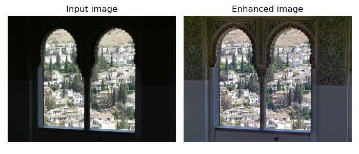
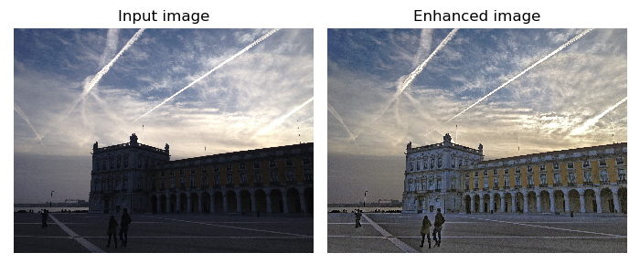
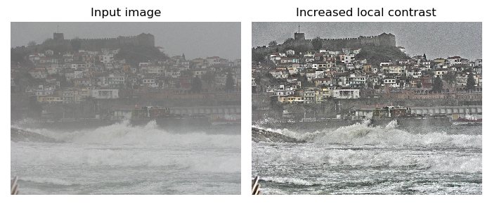
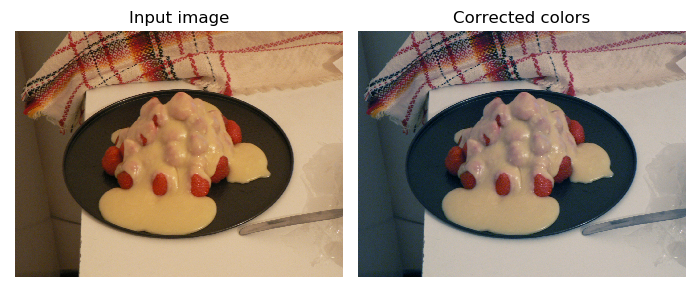
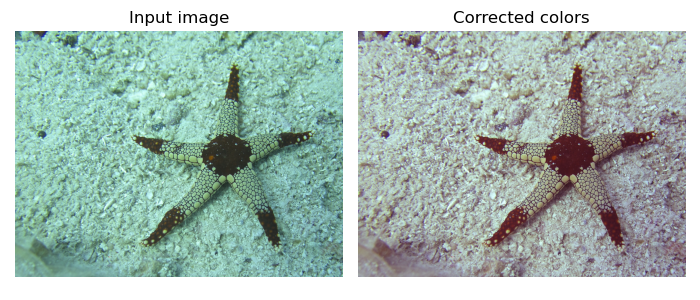
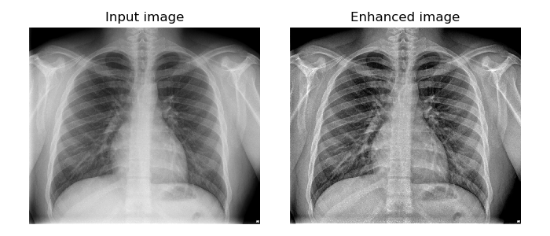
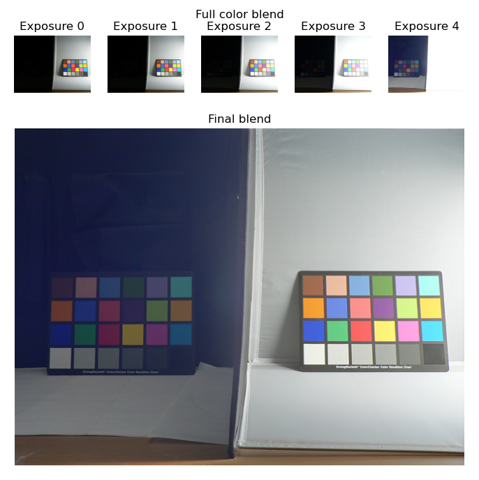

# image_enhancement
Library of NumPy-based and CUDA-based Image Processing functions for various types of Image Enhancement, including:
- Spatial Tone Mapping
- Local Contrast Enhancement
- Color Correction (White Balance)
- Color Saturation Adjustment
- Exposure Fusion

# Examples:





!


# Functions:
[/src/image_enhancement/core.py](/src/image_enhancement/core.py "/src/image_enhancement/core.py")  contains:
- **get_photometric_mask()**: Estimates local brightness distribution (edge-aware blurring).
- **apply_local_contrast_enhancement()**: Adjusts strength of local details.
- **apply_spatial_tonemapping()**: Adjusts brightness levels in dark and bright regions. 
- **transfer_graytone_to_color()**: Transfers tones from a tone-mapped grayscale image to a color image. 
- **change_color_saturation()**: Adjusts the color vibrance of an image. 
- **correct_colors()**: Removes color casts from images.
- **adjust_brightness()**: Adjusts global brightness of the image.
- **srgb_to_linear()**: Transforms image to the linear color space. 
- **linear_to_srgb()**: Transforms image to the gamma-corrected color space. 
- **enhance_image()**: Applies multiple stages of enhancement to an image. 
- **blend_exposures()**: Fuses a collection of image exposures to a single well exposed image. 

# Data conventions
Input/output ranges and dtypes intentionally differ between functions and are part of the API:
- Grayscale operators (`apply_local_contrast_enhancement`, `apply_spatial_tonemapping`, `adjust_brightness`) work on float [0,1] images and return float [0,1].
- `get_photometric_mask` accepts uint8 [0,255] or float [0,1] and returns float [0,1].
- `srgb_to_linear` accepts uint8 [0,255] (or float [0,1]) and returns float [0,1]; `linear_to_srgb` returns uint8 [0,255], which is efficient for display and storage.
- `transfer_graytone_to_color` returns uint8 [0,255] (display-ready).
- `change_color_saturation`, `correct_colors`, `enhance_image` and `blend_exposures` return float [0,1].

# Contents:
```tree
├── src
│   └── image_enhancement                      [The installable Python package]
│       ├── __init__.py                        [Public API re-exports]
│       └── core.py                            [Main module with all the functions]
├── examples                                   [Directory: Example scripts]
│   ├── example_adjust_image_brightness.py     [Example of adjusting global brightness]
│   ├── example_color_correction.py            [Example of applying color correction]
│   ├── example_enhance_image.py               [Example of combined image enhancement]
│   ├── example_local_contrast_enhancement.py  [Example of applying increasing local details]
│   ├── example_blend_exposures.py             [Example of blending multiple image exposures]
│   └── example_medical_image.py               [Example of processing medical images]
├── cuda                                       [Directory: CUDA implementation]
│   ├── image_enhancement.cu.h                 [Header file for CUDA implementation]
│   ├── image_enhancement.cu                   [Implementation of image enhancement in CUDA]
│   └── image_enhancement_cuda.py              [Script with ~most~ of the functions in CUDA]
├── tests
│   └── regression                             [Pixel-exact regression harness + golden references]
└── images                                     [Directory: Sample test images]
```

# Installation
From the repository root:

    pip install .

Or for development (editable install):

    pip install -e .

Optional extras:

    pip install .[plot]   # matplotlib, for verbose=True visualizations
    pip install .[cuda]   # pycuda + Pillow, for the CUDA pipeline

After installation the examples can be run from the `examples` directory:

    cd examples
    python example_enhance_image.py

# Dependencies
- numpy
- scikit-image
- imageio
- matplotlib (optional: only needed for `verbose=True` visualizations)
- Pillow (optional: only needed for running `cuda/image_enhancement_cuda.py`)
- pycuda (optional: only needed for running `cuda/image_enhancement_cuda.py`)

# Dataset
If you want to try this code in real-life challenging travel photos, please try the following dataset:

[TM-DIED: The Most Difficult Image Enhancement Dataset](https://sites.google.com/site/vonikakis/datasets/tm-died)

# Building CUDA code
The Python code loads a compiled cuda binary (`.cubin`) and runs the CUDA kernels using numpy arrays. Replace `[arch]` in the code below to compile the CUDA code (e.g. `-arch=sm_72`).

    nvcc --cubin -arch=[arch] -use_fast_math -O3 cuda/image_enhancement.cu -o cuda/image_enhancement.cubin

With `image_enhancement.cubin` in `cuda`, you can run `cuda/image_enhancement_cuda.py` to generate an enhanced version of `alhambra1.jpg`.

# Citations
If you use this code in your research please cite the following papers:   
1. [Vonikakis, V., Andreadis, I., & Gasteratos, A. (2008). Fast centre-surround contrast modification. IET Image processing 2(1), 19-34.](https://www.researchgate.net/publication/3481092_Fast_centre-surround_contrast_modification)
2. [Vonikakis, V., Winkler, S. (2016). A center-surround framework for spatial image processing. Proc. IS&T Human Vision & Electronic Imaging, (Retinex020), San Francisco, CA, Feb. 14-18.](https://www.researchgate.net/publication/312243692_A_center-surround_framework_for_spatial_image_processing)
3. [Vonikakis, V., Arapakis, I. & Andreadis, I. (2011).Combining Gray-World assumption, White-Point correction and power transformation for automatic white balance. International Workshop on Advanced Image Technology (IWAIT), 1569353295.](https://www.researchgate.net/publication/235350557_Combining_Gray-World_assumption_White-Point_correction_and_power_transformation_for_automatic_white_balance)
4. [Vonikakis, V., & Andreadis, I. (2008). Multi-Scale Image Contrast Enhancement. ICARCV 2008. (pp. 385-391).](https://www.researchgate.net/publication/221145067_Multi-Scale_Image_Contrast_Enhancement)
5. [Vonikakis, V., Bouzos, O. & Andreadis, I. (2011). Multi-Exposure Image Fusion Based on Illumination Estimation, SIPA2011 (pp.135-142).](https://www.researchgate.net/publication/235350562_Multi-Exposure_Image_Fusion_Based_on_Illumination_Estimation#share)
